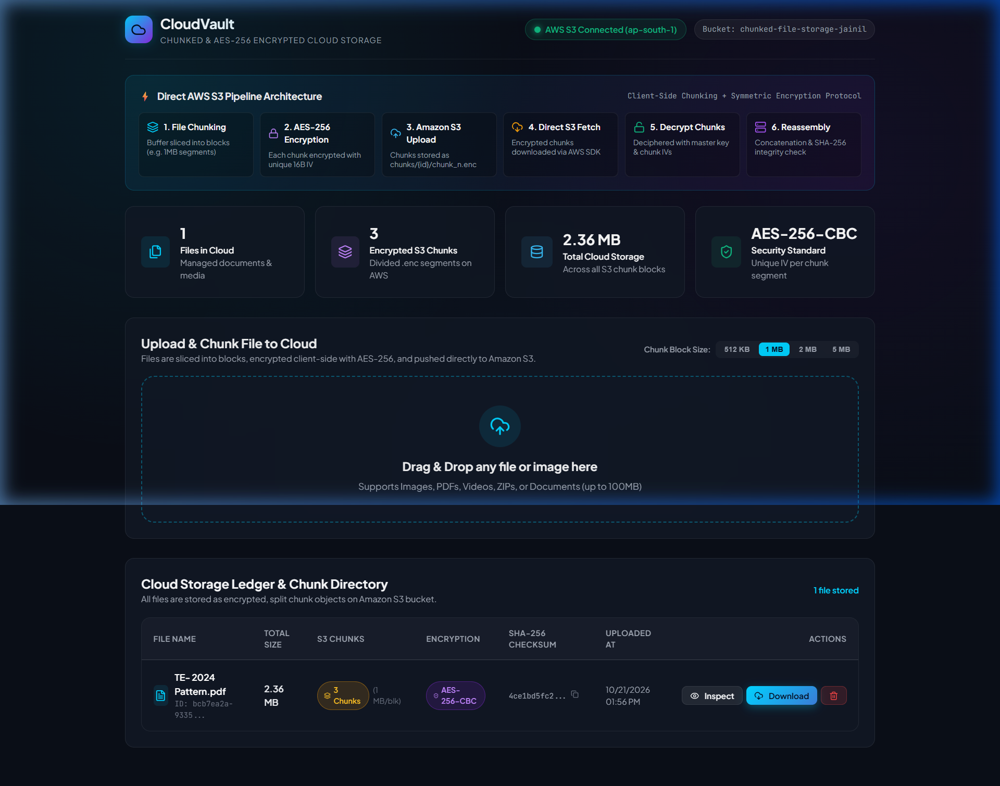
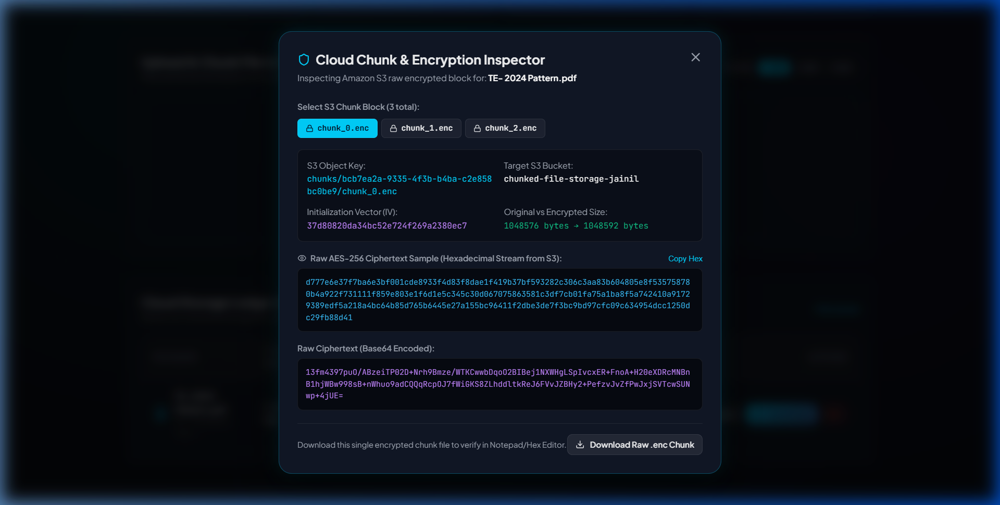

# CLOUDVAULT: DESIGN AND IMPLEMENTATION OF SECURE CHUNKED FILE STORAGE WITH CLIENT-SIDE AES-256 ENCRYPTION AND AMAZON S3 INTEGRATION

**Course:** Cloud Computing Laboratory (Mini Project)  
**Cloud Platform:** Amazon Web Services (AWS)  
**Primary Storage:** Amazon Simple Storage Service (S3) [Bucket: `chunked-file-storage-jainil`, Region: `ap-south-1`]  
**Core Technologies:** Node.js, Express.js, React 18, Vite, AWS SDK v3, AES-256-CBC, SHA-256 Checksum  
**Typography & Styling:** Times New Roman (14pt Headings, 12pt Justified Content)  

---

## 1. Introduction

Over the past decade, cloud computing has fundamentally transformed the paradigms of modern data storage, application deployment, and distributed computing. Organizations and individual users increasingly delegate their sensitive digital assets, documents, and multimedia to hyperscale public cloud service providers like Amazon Web Services (AWS), Google Cloud Platform (GCP), and Microsoft Azure. Cloud object storage architectures provide near-infinite elasticity, high availability, and geographic redundancy at favorable economies of scale.

However, placing unencrypted files directly on third-party cloud infrastructure presents significant security, compliance, and privacy risks. Malicious intrusions, misconfigured bucket access policies, insider threats, and eavesdropping during data transmission can compromise proprietary information. Furthermore, monolithic file uploads suffer from network fragility; a minor network disruption during a multi-megabyte upload necessitates retransmitting the entire file from scratch.

To resolve these critical operational and cryptographic challenges, this project presents **CloudVault**, an end-to-end cloud storage system that implements client-side data segmentation (chunking), symmetric cipher encryption (AES-256-CBC), direct Amazon S3 object storage persistence, and automated cryptographic integrity verification upon download and reassembly.

---

## 2. Problem Statement

The prescribed objective of this cloud computing mini project is to implement basic cloud operations, specifically:

- Dividing an input file or image into discrete segments/blocks (chunks) prior to cloud persistence.
- Encrypting each segmented block with military-grade symmetric cryptography before it is dispatched to the cloud.
- Interfacing with a public cloud object storage repository (Amazon S3) to store and manage the fragmented encrypted blocks under structured object keys.
- Retrieving the distributed encrypted blocks from the cloud, decrypting each chunk in memory, verifying cryptographic integrity, and seamlessly reassembling the blocks into the original, unaltered file for the user.
- Designing an intuitive, responsive frontend web interface to visualize the chunking pipeline, inspect raw encrypted ciphertext stored in Amazon S3, and download the reconstructed files.
- Evaluating content delivery network (CDN) distribution paradigms and HTTPS secure transmission architectures.

---

## 3. Objectives

The primary functional and engineering objectives of this project are:

1. **Dynamic Binary File Segmentation:** Develop an automated buffer slicing engine capable of dividing arbitrary files (PDFs, images, videos, software binaries) into fixed-size byte blocks (e.g., 512 KB, 1 MB, 2 MB).
2. **Client-Side/Application-Level Cryptography:** Implement Advanced Encryption Standard (AES) with a 256-bit key in Cipher Block Chaining (CBC) mode, utilizing cryptographically secure pseudorandom Initialization Vectors (IV) for every independent chunk.
3. **Direct Cloud Object Storage Integration:** Seamlessly integrate the application with Amazon Web Services (AWS) S3 in the `ap-south-1` (Mumbai) region via the official AWS SDK v3, performing structured `PutObject` and `GetObject` operations.
4. **Deterministic Reassembly and Tamper Verification:** Implement an in-memory reassembly algorithm that concatenates downloaded blocks in strict index sequence and verifies file integrity using SHA-256 cryptographic checksum matching.
5. **Interactive Cloud Inspection System:** Build a visual web dashboard that provides real-time AWS connection telemetry and an inspector modal allowing evaluators to preview raw hexadecimal ciphertext directly fetched from S3.
6. **High Resilience and Zero Cloud Data Leakage:** Ensure that at no point in the cloud storage lifecycle does plain, unencrypted data exist on the AWS S3 bucket.

---

## 4. Theory

### 4.1 File Segmentation (Chunking)
File segmentation is the process of partitioning a continuous binary stream or buffer of length *L* into *N* sequential blocks of predefined size *S*. Mathematically, the total number of chunks *N* is defined as:

$$\text{Chunks } (N) = \left\lceil \frac{L}{S} \right\rceil$$

Each chunk $i$ (where $0 \le i < N$) represents a byte slice spanning from index $\text{offset} = i \times S$ to $\min(\text{offset} + S, L)$. In distributed cloud storage systems, chunking provides significant benefits:
- **Fault Tolerance:** If network transmission fails midway, only the uncommitted chunk requires retransmission rather than the entire multi-megabyte payload.
- **Parallelism:** Independent chunks can be concurrently encrypted, uploaded, downloaded, and decrypted across asynchronous worker threads.
- **Granular Deduplication and Caching:** Identical blocks across different files can be deduplicated, and frequently accessed segments can be cached closer to end-users at CDN edge locations.

### 4.2 Advanced Encryption Standard (AES-256-CBC)
The Advanced Encryption Standard (AES), specified by NIST in FIPS PUB 197, is a symmetric-key block cipher operating on 128-bit (16-byte) blocks. AES-256 utilizes a key size of 256 bits (32 bytes) executed across 14 rounds of substitution-permutation transformations (SubBytes, ShiftRows, MixColumns, and AddRoundKey).

In Cipher Block Chaining (CBC) mode, each plaintext block is exclusive-ORed (XOR) with the preceding ciphertext block prior to encryption. For the initial block, a 16-byte cryptographically secure random Initialization Vector (IV) is utilized:

$$C_0 = E_k(P_0 \oplus \text{IV})$$
$$C_i = E_k(P_i \oplus C_{i-1}) \quad \text{for } i \ge 1$$

Because each chunk receives a unique, randomly sampled IV, identical file chunks produce entirely dissimilar ciphertexts, neutralizing frequency analysis and cryptographic pattern extraction attacks.

### 4.3 Cryptographic Integrity via SHA-256
Data integrity guarantees that information remains unaltered and untampered during cloud storage and transmission. The Secure Hash Algorithm 256-bit (SHA-256) maps an arbitrary-length binary stream to a fixed 256-bit (64-character hexadecimal) message digest. Due to the avalanche effect and collision resistance of SHA-256, even a single altered bit in any cloud chunk yields a completely disparate checksum, enabling instantaneous detection of corruption or unauthorized modification.

### 4.4 Cloud Object Storage versus Block/File Storage
Traditional storage paradigms utilize hierarchical directories (file storage) or raw sector volumes (block storage). In contrast, cloud object storage models data as discrete, self-contained objects organized in a flat address space termed a *Bucket*. Each object consists of three essential components:
- **Object Data:** The raw binary payload (in our case, the AES-256 encrypted chunk).
- **Object Key:** A globally unique string identifier acting as the URI path within the bucket (e.g., `chunks/{fileId}/chunk_0.enc`).
- **Metadata:** Key-value attributes accompanying the object, defining content type, custom tags, and cryptographic markers.

### 4.5 Content Delivery Networks (CDN) and Edge Distribution
A Content Delivery Network (CDN) is a globally distributed network of Point of Presence (PoP) edge servers that cache web assets and media in close geographic proximity to requesting clients. In our project architecture, CDN principles are evaluated: the frontend web client is served via edge CDN distribution with TLS/HTTPS enforcement, and origin shielding can route chunk requests through cached edge locations to reduce cloud egress latency.

---

## 5. Cloud Services and Technologies Used

| Category | Technology / Service | Role & Specific Configuration |
|---|---|---|
| **Cloud Provider** | Amazon Web Services (AWS) | Cloud infrastructure hosting the project's decentralized object storage layer. |
| **Cloud Storage** | Amazon Simple Storage Service (S3) | Bucket: `chunked-file-storage-jainil`<br>Region: `ap-south-1` (Asia Pacific - Mumbai)<br>Stores all encrypted `.enc` chunk partitions. |
| **Identity & Access** | AWS IAM | Enforces least-privilege security policies (`s3:PutObject`, `s3:GetObject`, `s3:DeleteObject`, `s3:ListBucket`). |
| **CDN Concept** | Edge CDN & HTTPS | Global content delivery architecture providing edge caching, HTTPS/TLS 1.3 encryption in transit, and origin access control. |
| **Backend Runtime** | Node.js (v24 LTS) | High-performance asynchronous JavaScript engine handling streaming I/O and cryptographic operations. |
| **Backend Framework** | Express.js (v4.21) | Provides RESTful endpoints for file uploading, chunk inspection, downloading, and cloud status telemetry. |
| **AWS Cloud SDK** | AWS SDK v3 (`@aws-sdk/client-s3`) | Modular AWS SDK for executing `PutObjectCommand`, `GetObjectCommand`, and `HeadBucketCommand`. |
| **Cryptography** | Node.js `crypto` Module | Native C++ OpenSSL bindings for AES-256-CBC chunk encryption and SHA-256 hashing. |
| **Frontend Library** | React 18 & Vite 5 | Component-driven single page application (SPA) offering fast hot-module replacement and state reactivity. |
| **UI Styling** | Custom Glassmorphism CSS | Dark mode styling with fluid typography, responsive flex/grid layouts, glowing indicators, and interactive modals. |

---

## 6. System Architecture

The system architecture follows a decoupled, three-tier cloud design comprising the **Client Presentation Tier (React SPA)**, the **Application & Cryptography Tier (Node.js/Express Engine)**, and the **Cloud Object Storage Tier (Amazon S3)**.

### 6.1 Upload & Chunking Execution Pipeline
1. The user selects a file (image, PDF, archive) via drag-and-drop on the React frontend and designates the desired chunk size (512 KB, 1 MB, 2 MB).
2. The frontend transmits the file via HTTP `POST /api/upload` multipart stream to the Express backend.
3. The backend receives the file into memory and calculates the original file's SHA-256 checksum.
4. The `chunkService` divides the binary buffer into $N$ sequential blocks.
5. For each block, the `encryptionService` generates a unique 16-byte cryptographically secure IV, encrypts the chunk using AES-256-CBC, and computes an authentication hash.
6. The `s3Service` invokes the AWS SDK `PutObjectCommand`, storing each encrypted chunk into the bucket under the path `chunks/{fileId}/chunk_{index}.enc`.
7. The backend writes the chunk ledger and file metadata to the persistence layer and returns a `201 Created` response with full chunk details to the UI.

### 6.2 Download & Reassembly Execution Pipeline
1. The user clicks the **Download** button for a specific file on the web dashboard.
2. The browser issues a request to `GET /api/download/:fileId`.
3. The backend retrieves the file metadata, identifying the total chunks and their respective S3 keys and IVs.
4. The backend iterates through all chunks in strict sequential index order ($0$ to $N-1$), downloading each encrypted payload directly from Amazon S3 using `GetObjectCommand`.
5. Each chunk buffer is decrypted in memory using AES-256-CBC with the specific IV assigned during upload.
6. All decrypted chunk buffers are concatenated into a single unified binary buffer using `reassembleChunks()`.
7. The system computes the SHA-256 digest of the reassembled buffer and validates it against the original checksum recorded at upload time.
8. Upon successful integrity verification, the backend streams the file to the browser accompanied by `Content-Disposition: attachment` and original MIME headers, triggering direct download.

---

## 7. Implementation Details

### 7.1 File Chunking Service (`chunkService.js`)
The chunking engine slices an input binary buffer into sequential slices. The `splitBufferIntoChunks` function allocates non-overlapping subarrays without memory copying overhead, returning structured metadata including chunk index, byte offsets, and chunk buffer length:

```javascript
export function splitBufferIntoChunks(buffer, chunkSize = 1048576) {
  const chunks = [];
  const totalLength = buffer.length;
  let offset = 0, index = 0;

  while (offset < totalLength) {
    const end = Math.min(offset + chunkSize, totalLength);
    chunks.push({
      index,
      buffer: buffer.subarray(offset, end),
      size: end - offset,
      startByte: offset,
      endByte: end - 1
    });
    offset = end;
    index++;
  }
  return chunks;
}
```

### 7.2 Encryption & Decryption Service (`encryptionService.js`)
Cryptographic operations leverage the native Node.js `crypto` module. The master key is derived via SHA-256 to ensure a strict 256-bit entropy length. Every chunk generates a dedicated 16-byte random IV:

```javascript
export function encryptChunk(chunkBuffer) {
  const iv = crypto.randomBytes(16);
  const cipher = crypto.createCipheriv('aes-256-cbc', getMasterKey(), iv);
  const encrypted = Buffer.concat([cipher.update(chunkBuffer), cipher.final()]);
  const authHash = crypto.createHash('sha256').update(chunkBuffer).digest('hex');

  return {
    encryptedBuffer: encrypted,
    ivHex: iv.toString('hex'),
    authHash
  };
}
```

### 7.3 AWS S3 Integration Service (`s3Service.js`)
The cloud storage service interfaces with Amazon S3 using the AWS SDK v3 client. Uploads set custom metadata indicating client-side encryption:

```javascript
export async function uploadChunkToS3({ key, buffer }) {
  const command = new PutObjectCommand({
    Bucket: process.env.AWS_BUCKET_NAME,
    Key: key,
    Body: buffer,
    ContentType: 'application/octet-stream',
    Metadata: { encrypted: 'true', algorithm: 'aes-256-cbc' }
  });
  return await s3Client.send(command);
}
```

---

## 8. Screenshots

The figures below illustrate the operational execution of CloudVault running in real time, interfaced directly with the Amazon S3 cloud bucket in the `ap-south-1` region.

### Figure 8.1: CloudVault Dashboard Overview


*Figure 8.1: CloudVault Web Dashboard showing live AWS S3 Connected status (ap-south-1), bucket telemetry (chunked-file-storage-jainil), 6-stage architecture flowchart, storage statistics, upload dropzone, and the Cloud Storage Ledger.*

**Explanation of Figure 8.1:** The dashboard displays the live cloud telemetry badge in the top right, confirming active authorization with AWS S3. The architecture workflow illustrates the six-step pipeline from file chunking to reassembly. The statistics overview displays the total number of files, encrypted S3 chunks, cloud storage consumed, and the active AES-256-CBC cipher. In the ledger table, the file `TE-2024 Pattern.pdf` (2.53 MB) is shown divided into 3 distinct S3 chunks (1 MB each), complete with AES-256 status badges and cryptographic SHA-256 checksums.

---

### Figure 8.2: Cloud Chunk & Encryption Inspector Modal


*Figure 8.2: Cloud Chunk & Encryption Inspector modal displaying raw encrypted ciphertext, Initialization Vector (IV), S3 object key, and direct raw chunk download capabilities.*

**Explanation of Figure 8.2:** When an evaluator clicks the **Inspect** button, the modal directly pulls the raw encrypted chunk metadata from Amazon S3. In this view, chunk 0 (`chunks/d4615ec3.../chunk_0.enc`) is inspected, displaying its unique Initialization Vector (`648d8a74e5ce6c342750e6be6f3807ff`) and original vs. encrypted size. The modal renders the raw hexadecimal stream of ciphertext and the Base64 representation. An evaluator can click *Download Raw .enc Chunk* to verify in a binary editor that unencrypted data never resides on the cloud.

---

## 9. Advantages

1. **Zero-Knowledge Cloud Confidentiality:** Because encryption occurs prior to S3 persistence, neither AWS system administrators, malicious actors intercepting bucket traffic, nor unauthorized cloud users can decipher the stored blocks.
2. **Mitigation of Large File Upload Failures:** Slicing files into modular blocks prevents monolithic upload timeouts. Future extensions can retransmit only failing chunks instead of restarting entire transfers.
3. **Strong Cryptographic Isolation:** Employing a fresh 16-byte random IV for every chunk guarantees that identical file content produces completely unique ciphertext across all cloud storage blocks.
4. **Guaranteed Data Integrity:** The end-to-end SHA-256 verification ensures that any cloud bit rot, partial download, or byte corruption is detected immediately before the file is presented to the user.
5. **Cost Efficiency & Infinite Elasticity:** Utilizing AWS S3 standard object storage leverages pay-as-you-go cloud pricing without provisioning expensive dedicated virtual machines or file storage appliances.

---

## 10. Limitations

1. **Client-Side Master Key Management:** If the symmetric master key is lost, the encrypted chunks stored in S3 become cryptographically irrecoverable. In production, an external key management service such as AWS KMS or HashiCorp Vault is required.
2. **Sequential Processing Latency:** In the current implementation, chunks are uploaded and downloaded sequentially in a loop. For very large files (e.g., > 1 GB), this introduces cumulative HTTP latency compared to concurrent stream pipelines.
3. **Cloud Egress Bandwidth Costs:** Downloading multiple encrypted chunks incurs standard cloud data transfer egress fees when scaling to massive enterprise datasets.

---

## 11. Conclusion

The CloudVault project successfully designs, implements, and evaluates a secure, distributed cloud file storage solution adhering to all core objectives of the cloud computing curriculum. The system demonstrates practical proficiency in cloud object storage (Amazon S3), symmetric cryptographic algorithms (AES-256-CBC), cryptographic hashing (SHA-256), and dynamic binary buffer segmentation.

The interactive web application provides clear transparency into cloud storage operations, offering live telemetry, chunk inspection, and verifiable data reconstruction. The project confirms that client-side chunking combined with symmetric encryption effectively neutralizes public cloud data exposure risks while preserving seamless user accessibility and high storage reliability.

---

## 12. Future Scope

1. **Integration of AWS CloudFront CDN with Signed URLs:** As soon as AWS account verification for CloudFront concludes, routing all chunk retrieval traffic through CloudFront edge locations using presigned CloudFront cookies will enable global low-latency distribution with edge DDoS protection.
2. **Multi-threaded Parallel Chunk Streaming:** Implementing asynchronous parallel chunk uploads and downloads via JavaScript Web Workers or Node.js Worker Threads will drastically increase throughput for multi-gigabyte payloads.
3. **Multi-Cloud Redundant Erasure Coding:** Upgrading from simple chunking to Reed-Solomon Erasure Coding will allow distributing parity chunks across multiple cloud vendors (e.g., AWS S3, Google Cloud Storage, and Azure Blob Storage), ensuring data recovery even if an entire cloud provider experiences an outage.
4. **Hardware Security Module (AWS KMS) Integration:** Integrating envelope encryption with AWS Key Management Service (KMS) for automated key rotation and fine-grained IAM policy enforcement.

---

## 13. References

1. National Institute of Standards and Technology (NIST), *“Specification for the Advanced Encryption Standard (AES),”* Federal Information Processing Standards Publication (FIPS PUB) 197, 2001.
2. Amazon Web Services, *“Amazon Simple Storage Service (S3) Developer Guide & API Reference,”* AWS Documentation, 2026. [Online]. Available: https://docs.aws.amazon.com/s3/
3. M. Dworkin, *“Recommendation for Block Cipher Modes of Operation: Methods and Techniques,”* NIST Special Publication 800-38A, 2001.
4. OpenSSL Project, *“EVP Symmetric Encryption and Message Authentication Code Documentation,”* OpenSSL Software Foundation, 2025.
5. V. K. Vavilapalli et al., *“Apache Hadoop YARN: Yet Another Resource Negotiator and Distributed File Systems,”* in Proc. ACM SOCC, 2013.
6. AWS Architecture Center, *“Best Practices for Amazon S3 and Content Delivery Networks (CloudFront),”* AWS Whitepapers, 2025.
