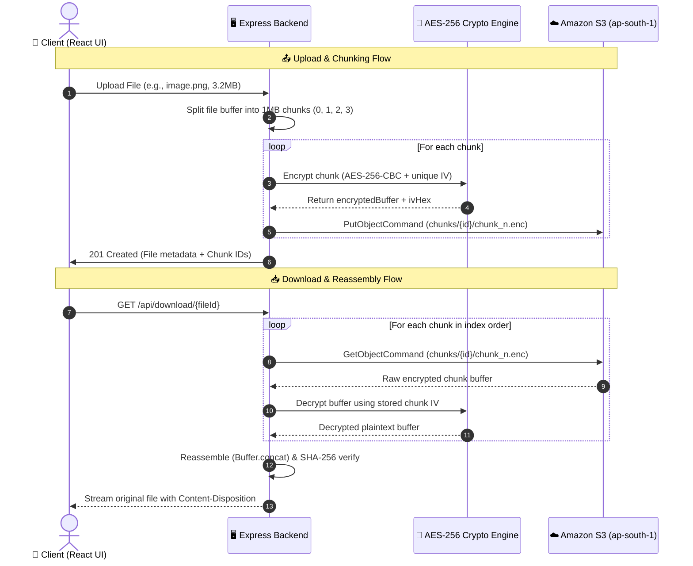

# ☁️ CloudVault — Chunked & AES-256 Encrypted Cloud Storage System
> **Cloud Computing Mini Project**  
> Direct AWS S3 Storage Pipeline &bull; Segmented Chunking &bull; Client-Side Symmetric Cryptography &bull; Interactive Web Dashboard

---

## 🎯 Problem Statement
> *“Implement basic operations such as divide the file into segments / blocks and download file from cloud in encrypted form. Host or interface with cloud object storage (Amazon S3) and integrate content delivery / HTTPS distribution.”*

This project provides a full-stack cloud application that:
1. **Slices any file** into configurable fixed-size binary blocks / chunks (e.g., 512KB, 1MB, 2MB).
2. **Encrypts each individual chunk** using **AES-256-CBC** with a unique Initialization Vector (IV).
3. **Uploads encrypted chunks directly to Amazon S3** under the path `chunks/<fileId>/chunk_<index>.enc`.
4. **Downloads and reassembles** all chunks from Amazon S3 on demand, decrypts them sequentially, and performs a **SHA-256 integrity check** to reproduce the identical original file.
5. **Provides an Encryption & Cloud Inspector** to preview raw ciphertext bytes from AWS S3, proving that no unencrypted data ever touches the cloud unauthenticated.

---

## 🗺️ System Architecture



---

## 🛠️ Technology Stack

| Layer | Component | Details |
|---|---|---|
| **Frontend** | React 18, Vite | Glassmorphism dark mode, responsive layout, Lucide icons |
| **Backend** | Node.js, Express.js | REST APIs, Stream handling, Multer memory storage |
| **Cloud Provider** | Amazon Web Services (AWS) | Amazon Simple Storage Service (S3) |
| **AWS Region** | `ap-south-1` (Asia Pacific - Mumbai) | Configured in S3 SDK v3 |
| **S3 Bucket** | `chunked-file-storage-jainil` | Dedicated cloud chunk storage |
| **Encryption** | AES-256-CBC | 256-bit symmetric key, 16-byte random IV per chunk |
| **Integrity** | SHA-256 | Cryptographic hash comparison before & after reassembly |

---

## 🚀 How to Run the Project Locally

### 1️⃣ Install Dependencies

Open a PowerShell terminal in the project root (`m:\Coding\Cloud Computing Mini project`):

```powershell
# Install backend dependencies
cd backend
npm install

# Install frontend dependencies
cd ../frontend
npm install
```

### 2️⃣ Start Backend Server (Port 5000)

In your first terminal:
```powershell
cd "m:\Coding\Cloud Computing Mini project\backend"
npm run dev
```
You should see:
```text
🚀 Cloud Storage Backend Server running on port 5000
👉 API Base: http://localhost:5000/api
[AWS S3] Testing connection to bucket: chunked-file-storage-jainil...
✅ AWS S3 Connected Successfully! [Region: ap-south-1, Bucket: chunked-file-storage-jainil]
```

### 3️⃣ Start Frontend Dev Server (Port 3000)

In a second terminal:
```powershell
cd "m:\Coding\Cloud Computing Mini project\frontend"
npm run dev
```

Open your browser and navigate to:  
👉 **`http://localhost:3000`**

---

## 🎓 Instructor Presentation / Demo Guide

Follow these steps to demonstrate the project to your evaluator:

1. **Show AWS Cloud Connectivity**:
   - Point out the green glowing **"AWS S3 Connected (ap-south-1)"** badge in the header.
   - Point out your bucket name: `chunked-file-storage-jainil`.
2. **Demonstrate File Slicing / Chunking**:
   - Select a sample image or PDF (e.g., 3 MB).
   - Set Chunk Size to **"512 KB"** or **"1 MB"**.
   - Watch the animated chunk pills (`chunk_0.enc`, `chunk_1.enc`, etc.) appear as the backend slices and uploads them.
3. **Show S3 Console / Encryption Proof**:
   - In the web table, click the **"Inspect"** button on any uploaded file.
   - Show the evaluator the **Raw AES-256 Ciphertext Hex Stream** and **Base64 sample** extracted directly from S3.
   - Click **"Download Raw .enc Chunk"** and open it in Notepad — show that it's unreadable encrypted binary.
4. **Demonstrate Reassembly & Integrity**:
   - Click **"Download"** on the file row.
   - The backend downloads all chunks from Amazon S3, decrypts each block, reassembles them, checks the SHA-256 checksum, and triggers the browser download.
   - Open the downloaded file to prove it is 100% intact and identical to the original!
